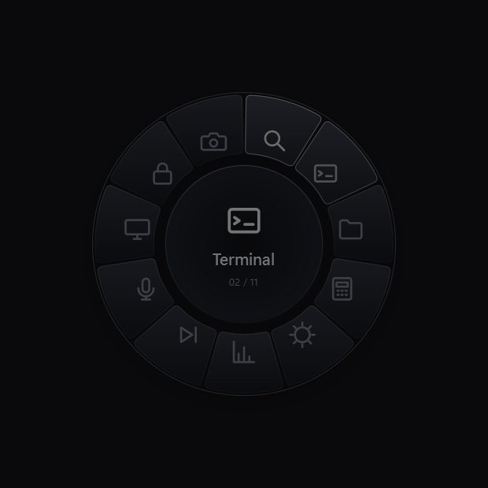
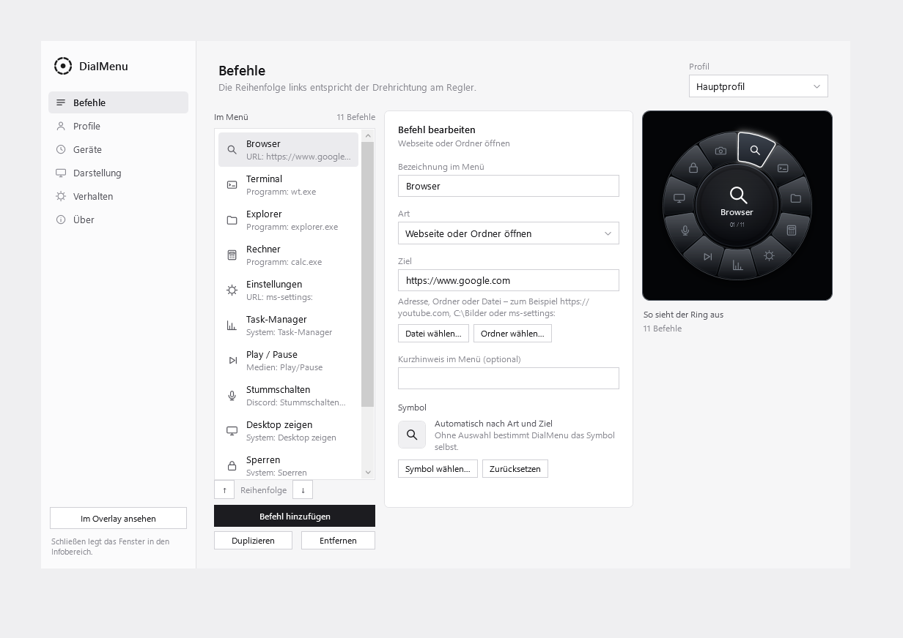
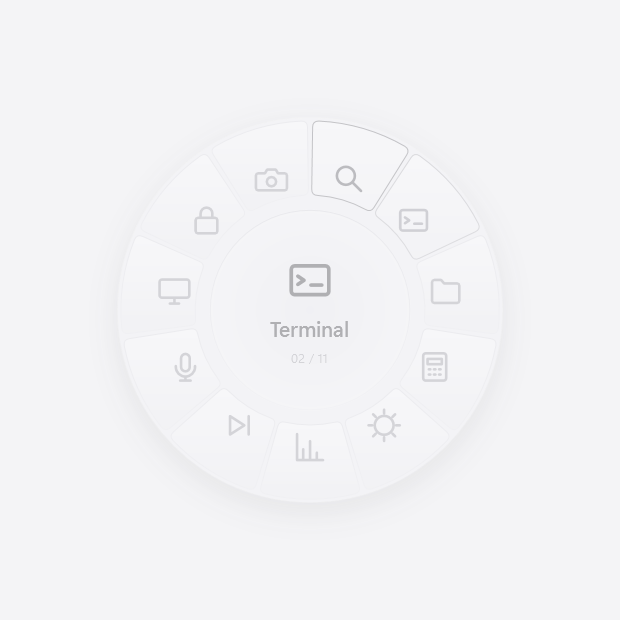

<div align="center">

# DialMenu

**Der Lautstärkeregler deiner Tastatur wird zum Menü.**

Ein radiales Menü, das den Drehknopf einer mechanischen Tastatur in einen
vollwertigen Programm- und Makro-Starter verwandelt.




[English](../README.md) · **Deutsch** · [Español](README.es.md) · [Русский](README.ru.md)

</div>

---

## Worum es geht

Viele mechanische Tastaturen haben einen Drehknopf, der fest auf Lautstärke
verdrahtet ist. DialMenu fängt diese Signale ab, bevor das System sie sieht,
und öffnet stattdessen ein Menü: **drehen wählt, drücken führt aus.**

Die Tastatur selbst wird dabei nicht verändert. Kein Flashen, keine Firmware,
keine Treiber. DialMenu hört nur mit — steck die Tastatur ab oder beende das
Programm, und alles ist wieder beim Alten.

```
   Drehen ──▶ HID-Report ──▶ DialMenu ──▶ Aktion
                              │
                              └──▶ das System sieht keine Lautstärke mehr
```

## Funktionen



- **Radiales Menü** — Glasflächen, monochrom, mit einem leuchtenden
  Auswahlrahmen. Beliebig viele Befehle, der Ring wächst mit.
- **Vier Ringthemen** in je zwei Helligkeiten, dazu Hell und Dunkel nach Wahl
  oder automatisch nach der Systemeinstellung.
- **Deutsch und Englisch**, umschaltbar ohne Neustart.
- **Programme, Ordner, Webseiten** — inklusive Auswahl aus den tatsächlich
  installierten Programmen statt Pfad-Tippen.
- **Tastenkombinationen** — `Ctrl+Alt+M`, `Win+D`, `Alt+F4` und alles dazwischen.
- **Makros** — Tastenkombinationen, Text und Pausen zu einer Sequenz verketten.
- **Discord** — Stummschalten und Taubschalten auf dem Ring.
- **Mehrere Profile** und **mehrere Geräte**.
- **Automatische Geräteerkennung** — dreimal rechts, dreimal links, drücken.
  DialMenu findet den Knopf selbst, ohne dass eine Kennung eingetragen wird.
- **Freie Platzierung** — zwölf Positionen plus der Monitor unter dem Mauszeiger.

## Installation

Windows 10 oder 11, .NET Framework 4.8 (auf Windows 11 vorinstalliert).
Es gibt kein Setup — DialMenu ist eine einzelne `.exe`.

1. [Neueste Version herunterladen](../../releases/latest)
2. `DialMenu.exe` in einen Ordner deiner Wahl legen
3. Starten — das Einstellungsfenster öffnet sich

Von hier aus braucht es zwei Klicks: unter **Geräte** auf *Erkennung starten*
und den Regler dreimal nach rechts, dreimal nach links drehen und einmal
drücken. Danach unter **Befehle** zusammenstellen, was im Ring stehen soll.

## Erste Schritte

**Welche Tastaturen funktionieren?**
Jede, deren Drehknopf Standard-Lautstärketasten sendet — das trifft auf die
meisten zu. Dank der automatischen Erkennung muss dafür nichts eingetragen
werden.

**Der Knopf reagiert nicht.**
Unter **Geräte** den Assistenten noch einmal laufen lassen. Der Fortschritt
(„rechts 1/3 · links 0/3") zeigt, ob überhaupt Signale ankommen. Wenn er bei
null bleibt, sendet die Tastatur etwas, das nicht als Media-Taste ankommt.

**Wo sind die Einstellungen, wenn der Knopf das Menü belegt?**
Im Infobereich der Taskleiste. Ein Klick darauf öffnet das Fenster.

**Kann ich die Lautstärke zurückbekommen?**
Ja: DialMenu im Infobereich beenden. Oder die Haken unter **Verhalten**
entfernen. Die Lautstärketasten der Tastatur selbst funktionieren währenddessen
unverändert.

## Konfiguration

Alles liegt in `%APPDATA%\DialMenu\config.json` — lesbar und versionierbar.
Ein Profil lässt sich kopieren und weitergeben.

## Selbst bauen



Voraussetzungen: Windows mit .NET Framework 4.8 und MSBuild (in Visual Studio
oder den Build Tools enthalten).

```powershell
.\build.ps1
```

Die fertige Datei liegt danach unter `bin\Release\DialMenu.exe`.

Ohne Visual Studio genügt die MSBuild-Version, die Windows mitbringt:

```powershell
& 'C:\Windows\Microsoft.NET\Framework64\v4.0.30319\MSBuild.exe' DialMenu.csproj /p:Configuration=Release
```

## Wie es funktioniert

Zwei Mechanismen greifen ineinander:

**Raw Input** liest die rohen HID-Pakete mit. Daraus ergibt sich, welcher
Rastschritt gedreht und wann gedrückt wurde — unabhängig davon, welche Tasten
das System daraus macht.

**Ein Tastatur-Hook** fängt die daraus entstehenden Lautstärketasten ab. Er
lässt sie nur dann durch, wenn sie *nicht* unmittelbar vom eigenen Gerät kamen.
Lautstärketasten anderer Programme und Tastaturen bleiben unberührt.

Beides läuft auf einem eigenen Thread. Der Grund ist gemessen: antwortet der
Hook nicht innerhalb von 300 ms, verwirft Windows die Taste und die Lautstärke
ändert sich trotzdem. Läuft er auf dem Oberflächen-Thread, passiert genau das,
sobald gezeichnet wird.

Selbst erzeugte Tastendrücke werden markiert und nie abgefangen — sonst würde
sich das Programm selbst blockieren.

## Plattformen

| | Stand |
|---|---|
| Windows 10 / 11 | fertig |
| macOS | geplant |
| Linux | geplant |

Beide Mechanismen, auf denen DialMenu beruht, sind plattformgebunden und haben
auf macOS und Linux kein direktes Gegenstück. Der Weg dorthin ist deshalb nicht
ein Port, sondern eine zweite Umsetzung: unter Linux über `evdev` und `uinput`,
unter macOS über `IOHIDManager` und `CGEventTap`. Das Rad selbst, die Themen und
die Bedienlogik sind davon unberührt und lassen sich übernehmen.

## Grenzen

- **Nur Geräte mit Standard-Media-Tasten.** Firmware, die ein eigenes Protokoll
  spricht, lässt sich nicht abfangen.
- **Ein Rastschritt weckt das Menü, er wählt noch nicht.** Sonst wäre der erste
  Schritt doppelt belegt.
- **Die Systemlautstärke entfällt am Knopf**, solange DialMenu läuft. Über die
  Lautstärketasten der Tastatur geht sie weiterhin.
- **Beschriftungen im Ring** erscheinen nur bei bis zu sechs Einträgen. Bei
  mehr passt kein deutsches Wort in den Bogen — dann bleiben die Symbole.

## Mitmachen

Fehlerberichte und Vorschläge sind willkommen. Wenn eine Tastatur nicht erkannt
wird, hilft ein Auszug aus der Anzeige unter **Geräte**.

## Lizenz

MIT — siehe [LICENSE](../LICENSE).
